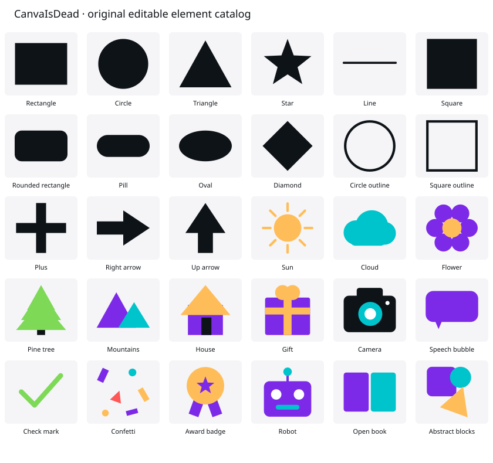

# Elements search and original catalog — 2026-10-15

## Comparison and scope

The official [add-elements guide](https://www.canva.com/help/add-elements/) describes keyword search, category browsing, See all, insertion and subsequent editing. The [Elements library guide](https://www.canva.com/design-school/resources/using-and-editing-elements/) also documents color/orientation filters, category-specific results, element menus, starring, related content, collections and dragging artwork onto a page. These are functional references, not evidence of exact visual or interaction parity.

Before this change, the clone's search field and fourteen category buttons had no actions. Only five individual shapes could be inserted. No reference/clone paired browser capture was obtained; the source and official reference documentation were compared.

## Implemented

- Search on Enter or the search button, case/accent normalization, multiple keyword matching, category-specific results and See all. The search term, category and filters survive switching editor panels. Clear and Escape reset the query; color, orientation and collection filters compose with it. Result counts and actual empty states replace silent controls.
- Thirty original, editable vector assets: fifteen geometric shapes and fifteen graphics. Artwork is built from existing rectangle, ellipse, triangle, star and line primitives, with no copied stock media, templates, logo, font or network dependency. Multi-part artwork inserts as an independent group, can be ungrouped/member-edited, and uses the existing selection, move, resize, history, local save, backup, clipboard and export paths.
- Insert at the page center or a desktop drag/drop point. Fresh element/group IDs preserve existing artwork; insertion is one history step. The default longest dimension is 30% of the page's shorter side. Re-measuring after scaling handles thin lines' minimum selection height. Desktop native dragging accepts only a known catalog ID inside the visible page; invalid/outside drops do not edit the design. Touch insertion uses a tap; physical-touch dragging is not implemented or claimed.
- Real recent additions (deduplicated, newest first, capped at 24) and starred items. Neither list is seeded. Versioned preferences are stored in the browser's existing account namespace, independent of design documents. They survive local navigation/reload. Storage failures retain pending writes and expose retry; malformed/future data is preserved, and conflicting tabs cannot overwrite a newer list. Preferences are not included in design backups or account handoff.
- More, right-click and Shift+F10 open Star/Unstar, Find similar and View collection actions. “Similar” uses an explicit shared tag, not a semantic/AI model. Arrow keys navigate asset tiles without nudging selected canvas artwork. Focus returns to the trigger, search or mobile canvas as appropriate. The existing menu supplies keyboard navigation and viewport clamping.
- Every category opens a real view. Photos routes to the local Uploads panel as an available alternative; stock media and absent video/audio, 3D, forms, sheets, tables, charts, animations, frames, grids and mockups state their current availability. Those features remain required work, not justified exceptions or paid gates.

## Evidence and verification

This contact sheet is generated from the same `elementAssetPreview` SVG output used by the panel and was rasterized locally with the existing Sharp toolchain for visual inspection. It is artwork evidence, **not a browser screenshot or a paired parity capture**. The inspection caught and corrected the check-mark join, sun-ray alignment and robot antenna. No image-generation or asset service was called.

Lint, typecheck, 317 unit tests across 26 files and production build pass with the existing dependency overlay. A clean dependency installation remains unverified; existing workspace-root, Next ESLint-plugin and Vitest configuration warnings remain. Ten new unit cases exercise search/filter composition, small/large page insertion, centered/drop geometry, independent editable groups, lock preservation, single-step history/page isolation, local reload, portable vector output, thumbnails and recent/starred storage failure/conflict behavior.

Playwright discovers 110 scenarios across 21 files, including ten new desktop/mobile instances for Elements. The native drag case explicitly skips the mobile project: desktop mouse automation would not establish physical-touch support. **No browser cases were executed.** The known runtime failures remain, and no browser tool is exposed. `elements-panel.png` is only the planned capture filename in the test; it is not present as browser evidence.

## Remaining differences

Capture original/before/after at 1440×900 and 390×844. Compare panel padding, icon sizes, thumbnail layouts, categories/results ordering, menus, labels, hover/focus states, keyboard movement, drag feedback and touch interactions. Test storage errors, two tabs, undo/reload, menu focus, insertion during text editing and encoded export pixels in a browser.

The library is intentionally small original artwork; it does not approach the reference's breadth. Native single-node compound shapes, shape text, line connectors/endpoints/styles, richer graphic recoloring, arbitrary polygon/vector import, asset folders, creator/metadata details, semantic matching, color-distance/custom-hex filters, animation filters and full stock/media/generation categories remain missing or incomplete. Exact recent-list semantics, initial sizing, orientation thresholds, mobile category presentation and drop placement are provisional pending direct comparison. No feature is excluded because the reference charges for it. Keep Elements and premium-equivalent catalog rows `differs`.

No dependency, service, secret, environment, authentication, analytics or payment configuration changes are included. Designs, preferences and artwork remain local.
